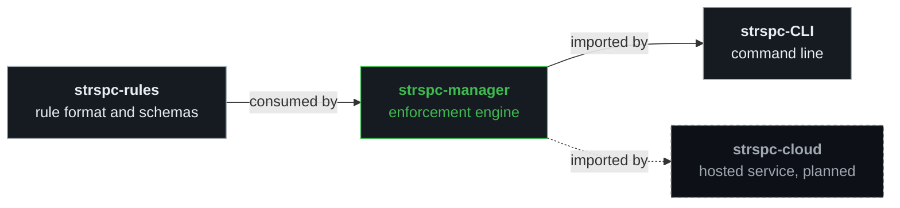

# Reference

Platform context, packages, evaluation providers, rule sources and Realms of
[strspc-manager](../README.md). The specification is [`SPEC.md`](SPEC.md).

## Architecture

The manager is the middle tier of the SteerSpec platform:

Validation and evaluation logic lives here. [strspc-CLI](https://github.com/SteerSpec/strspc-CLI)
imports the manager's public Go packages and presents the results.

## Packages

Public packages live under `src/`, for example
`github.com/SteerSpec/strspc-manager/src/rulelint`. Section numbers (§) refer to
[`SPEC.md`](SPEC.md).

### Foundation

| Package | Description |
| ------- | ----------- |
| `entity` | Shared domain types: `File`, `Entity`, `RuleSet`, `Rule`, `Note`, `RealmFile`. Includes `Parse([]byte)` and `Load(path)` for both file and HTTP consumers, the rule state machine, and the closed note-type enum (`NoteTypes`, `IsAppendOnlyNoteType`). |
| `entityops` | Mutations of an entity file that keep it valid: create an entity, add, edit, promote, retire, abandon and supersede rules, add and revise notes, check an `added_by` against the contributor format and a Realm's contributor list (`CheckAddedBy`), and rewrite `added_by` values across a file and its sub-entities to migrate them (`RewriteAddedBy`). `NewFile` starts a file at `rule_set.version` 0.1.0; every other operation changes an existing file and bumps that version (minor on promote/retire, patch otherwise). All of them refresh the timestamp and hash (§2.4). Operations act on the `File` they are given; callers bump the ancestors of a sub-entity, except for `RewriteAddedBy`, which bumps every file whose subtree it changed. |
| `result` | Shared `Diagnostic`, `Severity`, and `Result` types returned by all modules. `Codes` and `LookupCode` export the diagnostic code registry, each code with a title and a fix; [`diagnostic-codes.json`](diagnostic-codes.json) is the same data as JSON. |
| `schema` | Fetches and caches JSON schemas from `steerspec.dev` at runtime. `ForRealm` selects the core version a Realm pins, so a schema change reaches it through its pin. A test keeps embedded copies out of the binary. |
| `remote` | Fetches `github://` rule directories through the GitHub REST tarball endpoint and caches them locally (§6.4). Shared by `ruleresolve` and `realmresolve`, and limits which repository owners receive the GitHub token. |
| `render` | Renders entity files to human-readable formats; Markdown today, with an optional custom template (`WithTemplate`). Rule IDs are displayed in the RLIFRMT default format unless a Realm's `rule_identifier_format` is passed through `NewRuleIDFormatter` and `WithRuleIDFormatter`. `WithInheritance` adds an "Inherited rules" section. |
| `inherit` | Computes the effective rule set of an entity from a resolved inheritance chain. |

### Modules

| Package | Type | Description |
| ------- | ---- | ----------- |
| `rulelint` | deterministic, stateless | Validates entity files against schema and business rules (§7.1) |
| `rulediff` | deterministic, stateful | Validates rule lifecycle transitions across PR diffs (§7.2) |
| `rulehistory` | deterministic, stateless | Derives an entity's or rule's change history from successive versions of its file, one before/after pair per commit, without reading git itself (§6.2) |
| `ruleeval` | AI, pluggable providers | Evaluates code compliance against rules (§8.3). Batches rules per entity, caches verdicts, and degrades to static-only mode when no provider is configured. See [Evaluation providers](#evaluation-providers). |
| `evalcache` | deterministic | Persists `ruleeval` verdicts in an embedded key-value store at `.strspc/cache.db` with TTL expiry (§8.4) |
| `ruleresolve` | deterministic | Fetches, caches, and resolves rules from configured sources (§8.2) |
| `rulerefs` | deterministic, stateless | Validates the rule identifiers that text files cite against a set of known rules, and reports copied rule bodies (§6.2) |
| `realmlint` | deterministic, stateless | Validates Realm structure, `realm.json` manifests including sub-realms, EUID uniqueness, and, with `WithDependencyFetcher`, the Realm against its pinned dependencies |
| `realmresolve` | deterministic | Resolves Realm dependencies declared in `realm.json`, fetches remote Realms, and resolves inheritance chains across Realms |

## Evaluation providers

`ruleeval/providers.New(name, opts)` builds a provider from the `evaluator.provider`
value in `.strspc/config.yaml`:

| Provider | Status | Notes |
| -------- | ------ | ----- |
| `claude` | available | Anthropic Messages API via `ruleeval/claude`. Default model `claude-sonnet-5-5`, effort `medium`; structured outputs (verdicts keyed by rule id, then one detail request per violated rule that confirms or withdraws it); prompt caching on the system prompt and diff; API key from `ANTHROPIC_API_KEY` (workspace-scoped). |
| `static-only` (also `static`, `null` or omitted) | available | No AI calls; `ruleeval` emits `RE003` and only structural checks run. |
| `openai` | planned | Returns `ErrProviderNotImplemented` ([#67](https://github.com/SteerSpec/strspc-manager/issues/67)). |
| `ollama` | planned | Returns `ErrProviderNotImplemented` ([#67](https://github.com/SteerSpec/strspc-manager/issues/67)). |

Provider tests replay recorded HTTP cassettes from `src/ruleeval/claude/testdata/cassettes/`
and never call the network in CI. Set `STRSPC_RECORD=1` with an API key to re-record,
or run the live smoke test with `go test -tags live ./src/ruleeval/claude/`.

A GitHub Models provider is proposed in [#79](https://github.com/SteerSpec/strspc-manager/issues/79).

## Rule sources

The manager consumes rules and schemas published at
[steerspec.dev](https://steerspec.dev) from
[strspc-rules](https://github.com/SteerSpec/strspc-rules):

| Resource | URL |
| -------- | --- |
| Entity schema | `https://steerspec.dev/schemas/entity/v1.json` |
| Realm schema | `https://steerspec.dev/schemas/realm/v1.json` |
| Bootstrap schema | `https://steerspec.dev/schemas/entity/bootstrap.json` |
| Rules manifest | `https://steerspec.dev/rules/latest/index.json` |
| Versioned rules | `https://steerspec.dev/rules/v<version>/` |
| Versioned schemas | `https://steerspec.dev/rules/v<version>/_schema/` |

## Realms

Rules are organized into **Realms** — namespaces where Entity Unique Identifiers
(EUIDs) are unique. A Realm is any directory containing entity files and a
`realm.json` manifest:

- `strspc-rules/rules/core/` — the **core** Realm (ships with SteerSpec)
- An org spec repo — an **organizational** Realm
- `./rules/` in a consumer project — a **local** Realm
- `rules/` in this repository — `dev.steerspec.manager`, the engine's own rules,
	validated and evaluated in CI with the released CLI

## References

- [`docs/SPEC.md`](SPEC.md) — canonical Rule Manager specification
- [strspc-spec](https://github.com/SteerSpec/strspc-spec) — the cross-cutting platform rules
- [strspc-rules#17](https://github.com/SteerSpec/strspc-rules/issues/17) — 3-tier platform architecture decision
- [strspc-rules#19](https://github.com/SteerSpec/strspc-rules/issues/19) — Realm formalization decision
